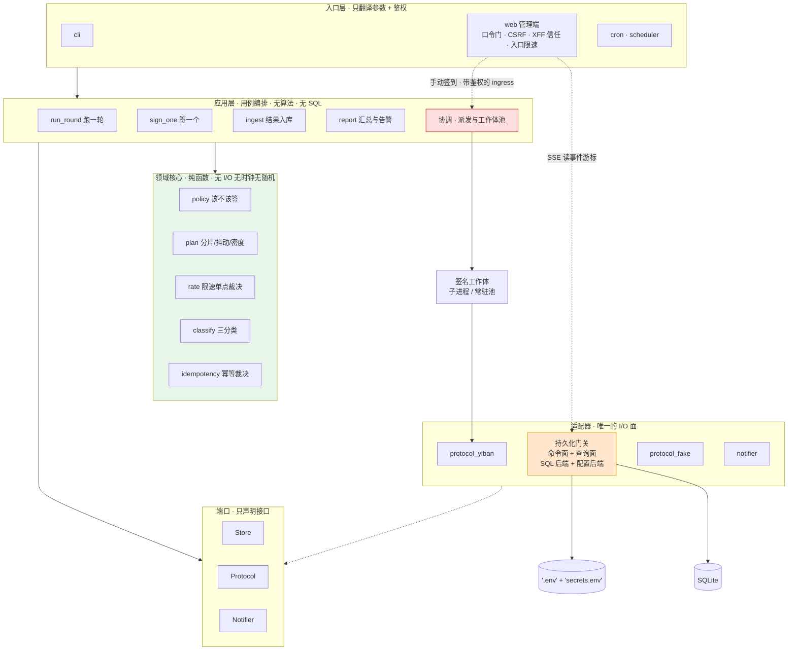
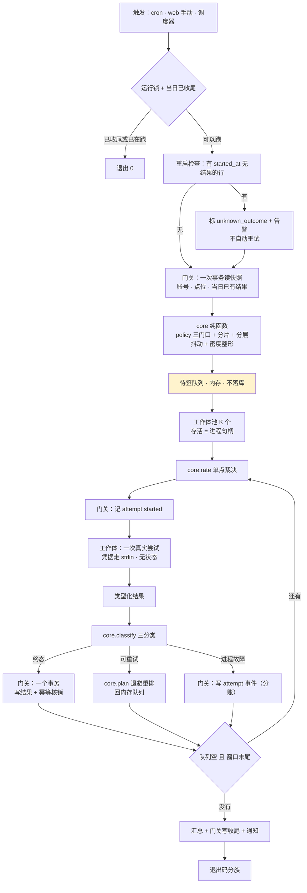
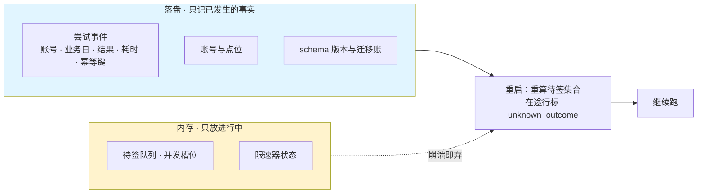
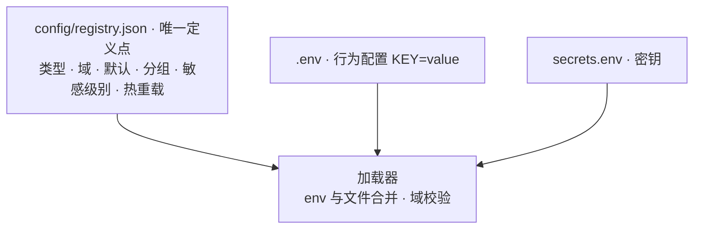

# 目标架构：分层与依赖方向（契约）

> **性质**：设计契约，不是建议。它是分层重构（简化批）的任务书依据。
> **脱敏口径**：本文只含契约部分。不含内部工单号、缺陷计数、主机与账号信息，也不含审查过程记录——那些属内部工作文稿，仅本地留存。
> **仲裁**：**以代码为准**。本文与代码不符时以代码为准，并在该批交付时刷新本文。

## 1. 分层与依赖方向



**依赖方向单向**：`entry → app → core`；`adapters` 实现 `ports`。web 只调 `app/`，不 import 持久化实现。

**三条层内红线**：

- `core`：无 I/O、无时钟、无随机——同一输入必得同一输出，可不用 mock 测。
- `app`：无 SQL；事务边界在这一层。
- `entry`：只翻译参数与鉴权，不含业务判据。

## 2. 层准入判据

| 层 | 准入判据 |
|---|---|
| `core` | 是纯函数吗；同一输入必得同一输出吗；能不用 mock 测吗 |
| `app` | 是「一次业务动作」吗；事务边界在这里吗 |
| `adapters` | 是唯一碰外部世界的地方吗 |
| `entry` | 只做参数翻译与鉴权吗 |

## 3. 目标目录树

> **已取代**：本节的目录树由 `docs/dev/target-tree.md` 取代。分层红线（§1）、运行时（§4）、
> 持久化（§5）、配置（§6）、施工判据（§7）与回退闸门（§8）继续有效。
> 目标树与命名以 `docs/dev/target-tree.md` 为准；该文同时登记现存空壳 `yiban/ports/`。

```text
yiban/
├── entry/                 # 入口层：只翻译参数 + 鉴权
│   ├── cli/               #   命令行入口。✅ 已落地（批 A1，2026-10-16）：
│   │                      #      旧入口转发壳已于 145-E 退役
│   └── （web 管理端独立于本包；docker/scheduler 为容器接线）
├── app/                   # 应用层：用例编排，无算法无 SQL
│   ├── round.py           #   run_round 跑一轮（现 engine/round）
│   ├── sign_one.py        #   sign_one（现 executor_v3 主流程）
│   ├── ingest.py          #   结果入库（现 executor_v3 落库段）
│   ├── report.py          #   汇总与告警（现 alerts）。✅ 已落地（批 B，2026-10-16）：落点是
│   │                      #      adapters/notifier/report.py，本行保留为目标名
│   └── coord.py           #   派发与工作体池（现 workers）。**未落地**：`engine/workers.py`
│                          #      批 B 已整文件搬入 workers/（见下）；把它的编排面拆上来属第三刀
├── core/                  # 领域核心：纯函数，无 I/O 无时钟无随机
│   ├── policy.py          #   该不该签（现 attempts/window 判定）
│   ├── plan.py            #   分片/抖动/密度（现 planner）
│   ├── rate.py            #   限速单点（现 token_bucket）
│   ├── classify.py        #   三分类（现 attempts 关键词表）
│   ├── idempotency.py     #   幂等裁决
│   ├── masking.py         #   脱敏（现 yiban/masking，纯函数）
│   ├── security_policy.py #   WAF 词表与白名单裁决（现 yiban/security）
│   └── elbow.py           #   ✅ 已落地（2026-10-12，第一枚 core 模块）：领取肘界谓词
│                          #      ——"谁该做"是行的函数（取代按进程身份的让位）；纯函数、时钟注入
├── ports/                 # 端口：只声明接口
│   ├── store.py           #   持久化契约
│   ├── protocol.py        #   协议契约
│   └── notifier.py        #   通知契约
├── adapters/              # 适配器：唯一 I/O 面
│   ├── persistence/       #   门关：命令面 + 查询面
│   │   ├── migrations/    #     迁移账（含方言差异）
│   │   └── audit.py       #     哈希链审计
│   ├── config/            #   env_io + 配置名册加载器 + secrets
│   ├── protocol_yiban/    #   ✅ 已落地（批 A2，2026-10-16）：洁净室协议库
│   ├── protocol_fake/     #   测试假服务器。✅ 已落地（批 A3，2026-10-16）：
│   │                      #      原 tests/fake_yiban_server.py
│   ├── notifier/          #   ✅ 已落地（批 A4，2026-10-16）：mail/ 与 notify/
│   │                      #      告警编排（engine/alerts.py）→ report.py，批 B 已搬入
│   └── statefiles/        #   状态文件 I/O（现 state_io）。✅ 已落地（批 B，2026-10-16）：
│                          #      state_io ＋ state_gc ＋ cred_state
└── workers/               # 签名工作体（slim；进程模型由测量决定）
                           #   ✅ 已落地（批 B，2026-10-16）：workers.py（原 engine/workers.py）。
                           #   已知张力：该文件一半是编排（派发与池），按第 1 节应属 app/coord；
                           #   拆分属第三刀
web/                       # HTTP 适配（独立包；routes 只翻译 + 鉴权）
frontend/                  # Vue（独立构建）
```

**域子包允许**：同一层内**新增的域子包**允许按域划分，条件是同一域 ≥3 个模块；不足 3 个平铺在层目录下。树中既有的单模块子包（如 `cli` 是 `entry` 层的入口条目、`protocol_yiban` 是 `adapters` 层的协议适配条目）是该层的**组成条目**，不属域子包，不受本条件约束。

### 每模块的演进映射

> 状态列以**代码为准**刷新（2026-10-16 批 B 交付）。批 B 是搬迁批，只搬坐标、不改行为。

| 现在的位置 | 目标层 | 处置 |
|---|---|---|
| `clock.py` `status.py` `window.py` `masking.py` `engine/hrw.py`（原 `yiban/` 顶层坐标） | `core/` | ✅ 已移动（批 B）。旧坐标转发壳已于 `145-E` 退役 |
| `engine/planner.py` `engine/schedule.py` `engine/token_bucket.py` | `core/`（`plan` / `rate`） | **未移动**。实测三者直接 import `yiban.adapters.*`（有 I/O）。**搬入 `core/`** 会造出 `core → adapters` 边，`core-no-upward` 判红（基线为空、门禁对任何违规红）。阻塞只对 `core/` 成立：实测搬去 `app/` 过门（违规 0），但那违反本表给它们定的目标层。须先切开纯算法与 I/O，属第三刀 |
| `engine/attempts.py` | `core/classify.py` + `core/policy.py` | 拆分移动（未做，第三刀） |
| `yiban/security.py` | `core/security_policy.py` | **未移动**。实测经 `yiban.challenge` 间接到 `adapters.protocol_yiban`，**搬入 `core/`** 同样判红（同上，阻塞只对该目标层成立）。须先切开，属第三刀 |
| `engine/round.py` `engine/alerts.py` | `app/` | ✅ 已移动（批 B）。`alerts` 落点＝`adapters/notifier/report.py` |
| `engine/runner.py` | `app/` | ✅ 已移动（批 B） |
| `engine/probe.py` | `app/`（探针＝一类用例） | ✅ 已移动（批 B） |
| `engine/workers.py` | `workers/` | ✅ 已移动（批 B，保留原名 ⇒ `workers/workers.py`）。已知张力：该文件一半是编排，按第 1 节应属 `app/coord`；拆分属第三刀 |
| `engine/executor_v3.py` | `app/sign_one` + `app/ingest` + `workers/` | 拆分（未做，第三刀） |
| `engine/state_io.py` | `adapters/statefiles/` | ✅ 已移动（批 B，I/O 面）。已知遗留向后边：导入 `yiban.engine.{cli_support,config_check,schedule}`，反转属第三刀 |
| `store/*`（除 migrations/audit） | `adapters/persistence/` | ✅ 已移动（批 B，保留原名） |
| `store/migrations.py` | `adapters/persistence/migrations/` | ✅ 已移动（批 B）。**保留原名** `migrations.py`，未建子包 |
| `store/audit_chain.py` | `adapters/persistence/audit.py` | ✅ 已移动（批 B）。**保留原名** `audit_chain.py` |
| `mail/` `notify/` | `adapters/notifier/` | ✅ 已移动（批 A4） |
| `yiban/infra/`（env_io / account_crypto） | `adapters/config/` | ✅ 已移动（批 B，保留原名） |
| `config_loader.py`（原 `yiban/` 顶层坐标） | `adapters/config/loader.py` | ✅ 已移动（批 B）。旧壳已于 `145-E` 退役 |
| `state_gc.py` `cred_state.py`（原 `yiban/` 顶层坐标） | `adapters/statefiles/` | ✅ 已移动（批 B，保留原名）。旧壳已于 `145-E` 退役 |
| `cli.py`（原 `yiban/` 顶层坐标） | `entry/cli/` | ✅ 已移动（批 A1）。旧壳已于 `145-E` 退役 |
| `web/app.py` 再导出表 | 打桩面迁移完成后删除 | 拆解（与测试定型同批） |
| `web/routes/` `services/` | `entry`（HTTP）／`app`（用例） | 归层 |
| `docker/scheduler.py` | 容器入口 | 保持 |
| `frontend/` | 独立构建 | 保持 |

**不过关的候选保持不动**——不为目录好看强拆。

## 4. 运行时流程（目标）



**崩溃语义（必须钉死）**：

1. 每次真实尝试之前，先记一行「尝试已开始（带 `started_at`）」。
2. 协调者启动时检查「有 `started_at`、无结果」的行：标 `unknown_outcome`、响亮告警、**不自动重试**。
3. 判据：**漏签可接受，双登录不可接受**。在途集合只有 K 条（K ＝ 并发工作体数），崩溃影响面有界。

## 5. 持久化边界（目标）



## 6. 配置与密钥分层（目标）



三层职责：**名册**（`config/registry.json`）是默认值与合法域的唯一来源；**`.env`** 只放行为配置；**`secrets.env`** 只放密钥。迁移期密钥双写一个版本周期，加载器读 `secrets.env` 优先。

## 7. 施工判据

1. **拆分六判据**：独立领域／分别修改／可独立测／不同依赖／公共容器／牵连无关——**不过关保持不动**。
2. **执行前十问**：其中「能否更小改动」为可是即选小。
3. **单向依赖铁律**：`entry → app → core`；`adapters` 实现 `ports`；web 不 import 持久化实现。
4. **行为保持**：每步「读断言 → 移动 → 全量跑测 → diff 检查」；发现无关缺陷不顺手修。
5. **打桩面迁移与拆分同一批**：不许「先拆后改测试」；分层重构必须与测试定型同批。

## 8. 回退闸门：人工复核（契约，工单 `uob1` X3）

**本次调度重构不提供运行期回退开关**：不存在 `YIBAN_FLOW`，也不要新增（`YIBAN_LEGACY_LOGIN` 属登录协议轴，与本回退无关）。旧流程代码本体已删，
没有"old"可切。**回退＝`git revert` 到上一版提交 ＋ 重启**，由人工执行。

**触发＝人工复核**：值守管理员按三条判据判断（漏签率、`unknown_outcome` 条数、管理员
告警条目数）。判据的取数位置、回退四步与阈值定档状态写在
`docs/dev/scheduler-v3.md §8`（唯一事实源）；本节只钉两条：**没有运行期开关**、
**回退是人工动作**。不要再把这套写成"自动闸门"——汇报时必须按**纸面闸门/人工复核**称呼。

---

## 附录：§4 运行时流程的白话对照（**非规范**）

> 本附录只为对外讲解。它与正文契约冲突时，以 §1–§8 的正文与代码为准。

**一句话**：一轮签到只干四件事。先看能不能开跑。再算出这一轮该签谁。然后一个个去签。最后写账收工。

**逐步说**

1. **有人按了开始。** 三种入口：每天定时自动跑、有人在网页上手动点、调度器派活。
2. **先看能不能开跑。** 系统问两个问题。今天这一轮已经结束了吗？现在就有一轮在跑吗？只要有一个答"是"，本轮什么都不做，正常退出。这一条防的是一天签两遍。
3. **开跑前先对上一轮的账。** 如果发现上次有账号"已经登记要签、但没留下结果"（通常是进程被杀），系统把它们标成"结果不明"，发告警让人看见，**但不自动补签**。
4. **一次读齐今天的情况。** 今天的账号名单、每个账号绑的签到点、今天已经签出的结果，一次读完。只读一次是为了后面判断前后一致；边签边看会把同一件事数两次。
5. **算出这一轮该签谁。** 这一步只做计算。它不碰网络、不看时钟、不掷骰子。好处是同一个输入永远得同一个结果，测试时不用造假数据。它决定三件事：谁该签（不该签的直接排除）、把大家的签到时间打散（避免所有账号挤在同一秒）、整体节奏多密。
6. **名单先放内存。** 算出来的待签名单不写数据库。这些是"还没发生的事"；进程崩了就该丢，重启后重算。
7. **叫上一批签到手。** 按并发数开若干个签到手（各自独立进程）。每个签到手一次只处理一个账号。判断签到手还活着，直接看它的进程句柄，不看心跳文件。这就是"存活 = 进程句柄"的意思。
8. **动手之前先记一笔"要开始了"。** 这是全流程最要紧的一笔安全动作。每次真的去登录之前，先在库里写一行"某账号在本轮已开始"。它的唯一用途是：万一进程这时死了，下次启动能查出"这个账号当时正在签"，从而不重复签它。
9. **真去登录。** 签到手拿到凭据（凭据从标准输入递进去，签到手自己不存任何东西），发起一次真实登录，得到一个结果。
10. **给结果分三种去向。** ① **定局**：签成了，或明确签不成（凭据错、定位失败一类），不再重试。② **可以再试**：网络抖动、服务器忙一类，等一小会儿再排回队列。③ **签到手自己挂了**：单独记一笔事件，不把这笔算成账号的成败。
11. **写账。** 定局的结果在一个事务里落库（要么全写成、要么全不写，不留半条）；可重试的排回内存队列；签到手故障的单独记事件。
12. **继续还是收工。** 只要队列里还有人、并且还在今天允许签到的时间段内，就回到第 8 步再来一遍。否则收尾：汇总当天结果、写下"本轮结束"、发通知、按结果类型返回退出码。

**讲这三句就够**（三条不变式）

- **宁可漏签，不可双登录。** 所有跟重试有关的设计都服从这一条。
- **已经发生的事才落盘，正在进行的只放内存。** 崩了就重算，不留半成品。
- **纯计算和碰外面的东西分开。** 算的部分不碰网络、数据库、时间，好测。碰外面的部分只有一处出口，好管。
